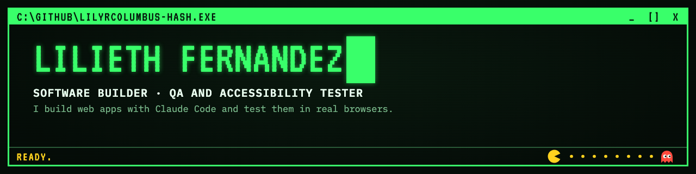
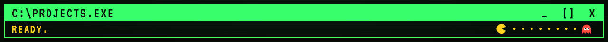
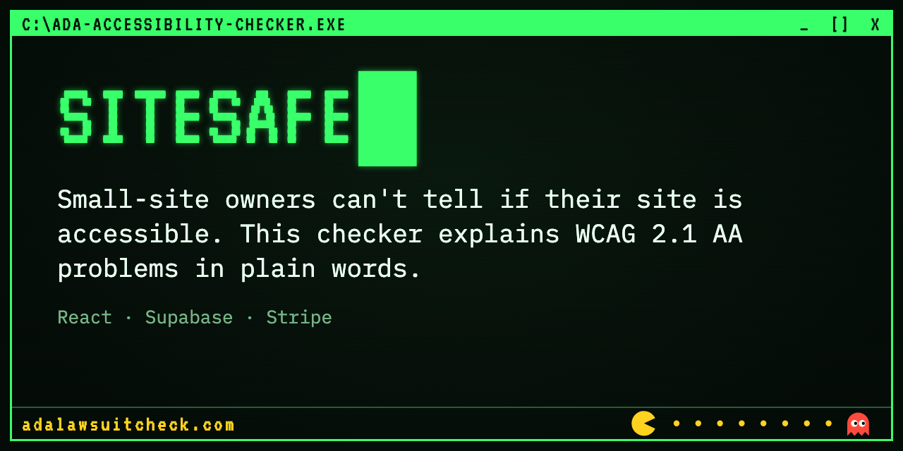
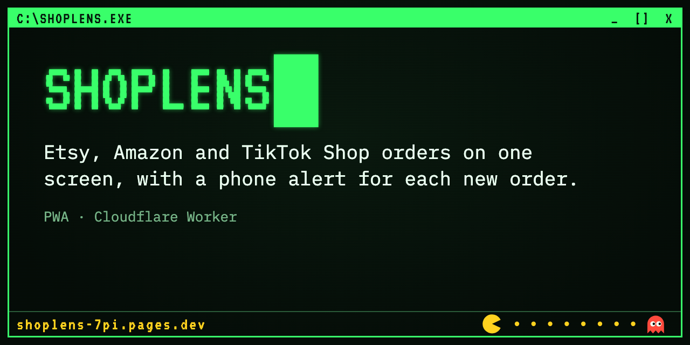
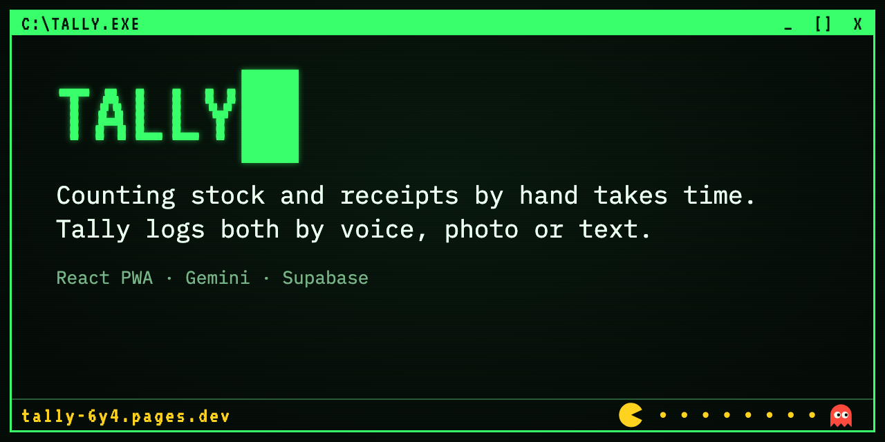
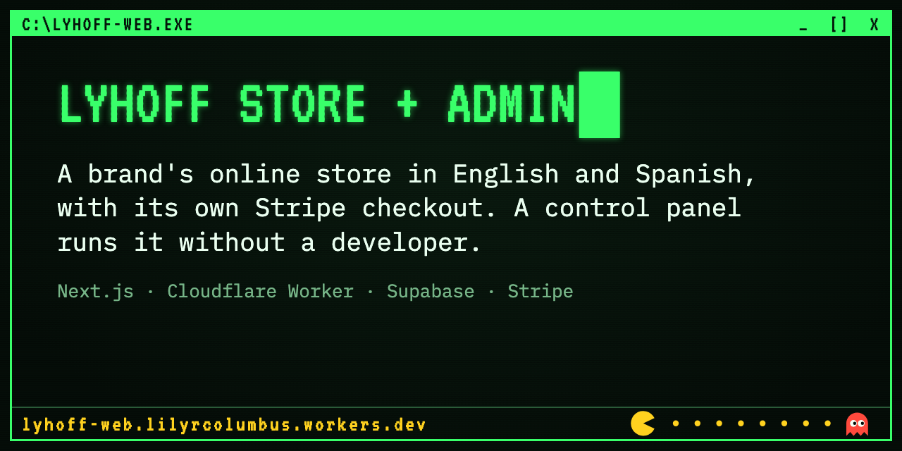
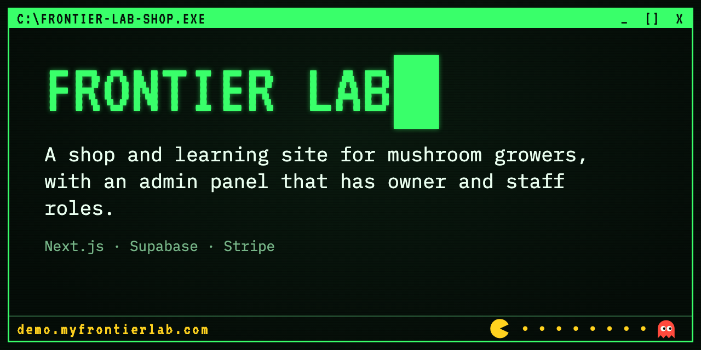
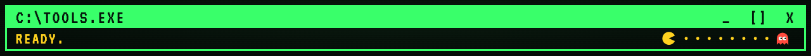

<p align="center"></p>

```text
C:\> type about.txt

I build web apps with Claude Code and test them in real browsers
before they go live.

Co-founder of LYHOFF LLC (natural products) and Frontier Lab
(mushroom cultivation). 6 projects launched.

Spanish (native) | English (intermediate)

C:\> _
```

<p align="center"></p>

Click a card to open the live project.

<table>
<tr>
<td width="50%"><a href="https://adalawsuitcheck.com"></a></td>
<td width="50%"><a href="https://shoplens-7pi.pages.dev"></a></td>
</tr>
<tr>
<td width="50%"><a href="https://tally-6y4.pages.dev"></a></td>
<td width="50%"><a href="https://lyhoff-web.lilyrcolumbus.workers.dev"></a></td>
</tr>
<tr>
<td width="50%"><a href="https://demo.myfrontierlab.com"></a></td>
<td></td>
</tr>
</table>

| Project | The problem, and the proof | Live | Code |
|---|---|---|---|
| **SiteSafe** | Small-site owners can't tell if their site is accessible. The checker scans against WCAG 2.1 AA and explains each problem in plain words. 3 real gaps fixed in production. | [adalawsuitcheck.com](https://adalawsuitcheck.com) | [ada-accessibility-checker](https://github.com/lilyrcolumbus-hash/ada-accessibility-checker) |
| **ShopLens** | Sellers check Etsy, Amazon and TikTok Shop one by one. One screen for all three, with a phone alert for each new order. 4 bugs found and fixed in a real browser, including a CORS error that broke every disconnect button. | [shoplens-7pi.pages.dev](https://shoplens-7pi.pages.dev) | [shoplens](https://github.com/lilyrcolumbus-hash/shoplens) |
| **Tally** | Counting stock and receipts by hand takes time. Tally logs both by voice, photo or text. Three pages showed different stock; one shared calculation fixed it. | [tally-6y4.pages.dev](https://tally-6y4.pages.dev) | [tally](https://github.com/lilyrcolumbus-hash/tally) |
| **LYHOFF Store + Admin** | A brand's online store in English and Spanish, with its own Stripe checkout and a control panel to run it without a developer. A database permissions hole found and closed. | [store](https://lyhoff-web.lilyrcolumbus.workers.dev) · [admin demo](https://lyhoff-web.lilyrcolumbus.workers.dev/admin/) | [lyhoff-web](https://github.com/lilyrcolumbus-hash/lyhoff-web) |
| **Frontier Lab** | A shop and learning site for mushroom growers, on the same engine. Owner and staff roles checked in three layers: screen, server and database. | [demo.myfrontierlab.com](https://demo.myfrontierlab.com) | [frontier-lab-shop](https://github.com/lilyrcolumbus-hash/frontier-lab-shop) |

The admin demos open with one click, are read-only, and hide customer data. Payments are off in the public demos.

<p align="center"></p>

```text
AI building   Claude Code, Claude and Gemini APIs, Playwright agents, MCP
Web           TypeScript, React, Next.js, Tailwind, Supabase, Cloudflare Workers, Stripe, Resend
Testing       End-to-end tests (Playwright), clear bug reports, WCAG 2.1 AA checks
Security      Row level security, webhook signatures, read-only demo accounts
```

<p align="center"></p>

codebake.SaaS@outlook.com
